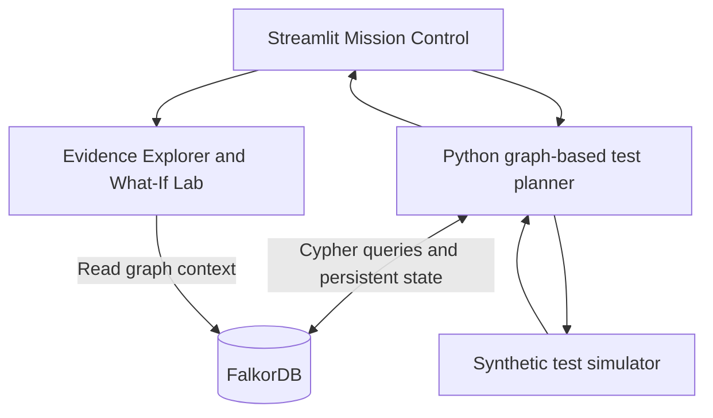
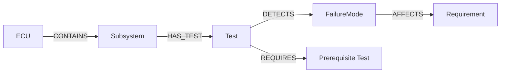

# TestPilot AI

**Graph-Powered Automotive ECU Test Planning with FalkorDB**

TestPilot AI is a working, deterministic agent prototype that uses **FalkorDB as its context and memory layer** to plan synthetic automotive ECU validation tests, explain selections, record results, and replan after failures. Its Streamlit dashboard includes **Mission Control**, an **engineering Evidence Explorer**, a **Graph What-If Lab**, and a persistent **History & Export** view.

> **Scope:** This is a synthetic engineering demonstration. It does **not** communicate with vehicle ECUs, execute real hardware tests, identify verified root causes, or claim compliance with ISO 26262.

## Graph Hacks 2026 submission

| Item | Details |
|---|---|
| Hackathon | Graph Hacks 2026 — WeMakeDevs × FalkorDB |
| Primary track | **Agents That Act on Connected Data** |
| Repository | [github.com/safiul167/TestPilot-AI](https://github.com/safiul167/TestPilot-AI) |
| Demo video | **Pending upload — add an accessible video link before submitting** |
| Deployment | **Local, reproducible setup** using Docker Compose and Streamlit (instructions below) |
| AI assistance | Disclosed under [AI Assistance Disclosure](#ai-assistance-disclosure) |

## Problem

Automotive ECU validation involves deciding which tests to run under a limited time budget. Different tests cover overlapping failure modes, some tests depend on earlier tests passing, and failed tests should influence the next investigation. A fixed checklist does not easily capture these connected dependencies or preserve decision context between runs.

## What TestPilot AI does

1. Retrieves test coverage, associated requirements, risk weights, detection probabilities, and prerequisite relationships from FalkorDB.
2. Filters out previously executed tests, tests with unmet prerequisites, and tests that exceed the remaining time budget.
3. Scores eligible tests and selects the highest-ranked next action.
4. Executes a **deterministic synthetic** ECU test (not a physical test).
5. Persists the selected decision, synthetic outcome, remaining time, and failure-mode concerns in FalkorDB.
6. Reloads this graph context and recalculates the next test recommendation.
7. Lets users explore evidence paths and run non-destructive graph-edge-removal experiments.

### Architecture



**FalkorDB is essential to operation:** The decision engine reads the connected graph to determine coverage and prerequisites. It also retrieves session history and suspected failure modes to change future priorities. The What-If Lab demonstrates that excluding one `DETECTS` relationship **in a temporary Python copy of FalkorDB-derived context** changes the recommendation. The underlying stored graph is not modified.

## Graph model

### Nodes

| Node label | Purpose |
|---|---|
| `ECU` | Synthetic ADAS camera ECU |
| `Subsystem` | Power, watchdog/MCU, Ethernet, or camera interface |
| `Test` | Validation procedure and simulated duration |
| `FailureMode` | Potential fault condition and synthetic risk weight |
| `Requirement` | Engineering requirement affected by a failure mode |
| `Session` | Test budget and persistent validation campaign state |
| `TestRun` | Recorded synthetic test result |
| `Decision` | Recorded test selection, priority, and remaining time |

### Relationships

| From | Relationship | To | Why it matters |
|---|---|---|---|
| `ECU` | `CONTAINS` | `Subsystem` | ECU structure |
| `Subsystem` | `HAS_TEST` | `Test` | Test ownership |
| `Test` | `DETECTS` | `FailureMode` | Detection coverage and probability |
| `FailureMode` | `AFFECTS` | `Requirement` | Requirement traceability |
| `Test` | `REQUIRES` | `Test` | Execution prerequisites; arrow points to prerequisite |
| `Session` | `HAS_DECISION` | `Decision` | Selection memory |
| `Decision` | `SELECTS` | `Test` | Explains the selected test |
| `Session` | `HAS_RUN` | `TestRun` | Historical outcomes |
| `TestRun` | `FOR_TEST` | `Test` | Connects result to test |
| `TestRun` | `SUSPECTS` | `FailureMode` | Records an unconfirmed investigation concern |

**Initial engineering graph:** 1 ECU, 4 subsystems, 8 tests, 6 failure modes, and 6 requirements — **25 nodes and 32 relationships** before session data is added.



See [graph architecture and detailed model](docs/graph_model.md) and [Cypher query examples](docs/queries.cypher). The Python source in `src/run_agent.py` contains the parameterized production queries used for recommendations and persistence.

## Test selection and replanning

For each eligible test, the planner uses a transparent score:

\[
\text{Priority}(t) =
\frac{
\sum_{f \in F_t}
\left(R_f \times P_{t,f} \times M_f\right)
}{
D_t
}
\]

Where:
- \(R_f\) = Risk weight of failure mode \(f\).
- \(P_{t,f}\) = Detection probability for test \(t\) and failure \(f\).
- \(M_f\) = Concern multiplier (2.0 if suspected; otherwise 1.0).
- \(D_t\) = Test execution duration in minutes.
- \(F_t\) = Failure modes connected to test \(t\).
2. Add a worked example
For TEST-002 (Power Rail Monitoring), your synthetic dataset contains:
\[
\text{Priority}=\frac{8(0.50)+9(0.95)}{8}
=\boxed{1.569}
\]

The synthetic concern multiplier is **2.0** when a failure mode was previously suspected in the session, and **1.0** otherwise. This is a **greedy demonstration heuristic**, not a calibrated safety-risk metric or a globally optimal schedule.

### Worked synthetic scenario

1. At the start of a new session, the agent selects **TEST-002 — Power Rail Monitoring** (score **1.569**).
2. The simulator returns `FAIL` and the run is linked to **FM-002 — Undervoltage Detection Failure** as a *suspected* cause.
3. After eight simulated minutes, the agent reads the saved graph history and recommends **TEST-001 — Power Transient** (score **1.720**).
4. TEST-001 returns `PASS`; the saved history still retains the earlier unresolved suspicion.
5. The agent continues selecting eligible tests while respecting budget and prerequisites.

### Graph What-If Lab

Without changing FalkorDB, the lab can temporarily exclude the `TEST-002 -[:DETECTS]-> FM-002` relationship from the in-memory evidence used for scoring:

| Scenario | Top recommendation | Score |
|---|---|---:|
| Original evidence | TEST-002 — Power Rail Monitoring | 1.569 |
| Hypothetical edge removed | TEST-005 — MCU Reset Handling | 1.185 |

This is an **evidence sensitivity experiment**; it is not a real graph edit or a validated causal intervention.

## Interactive dashboard

- **Mission Control:** remaining simulated minutes, completed tests, failed tests, unresolved concerns, recommendation and priority evidence.
- **Execute one / execute all:** run a single synthetic test or continue until no eligible tests remain.
- **Eight-test validation matrix:** test durations, status, and prerequisites.
- **Evidence Explorer:** visualize `Test → FailureMode → Requirement` connections.
- **Graph What-If Lab:** compare baseline and hypothetical graph-informed rankings.
- **History & Export:** inspect persisted decisions and outcomes and download a JSON evidence report.

## Verified results

These results were observed during development and in a fresh GitHub clone **using an already-running, previously populated FalkorDB instance**:

| Verification | Observed result |
|---|---|
| Automated regression tests | **12/12 passed** (7 planner / graph tests + 5 What-If tests) |
| Synthetic full campaign | **8/8 tests executed** |
| Synthetic test outcomes | **7 PASS, 1 FAIL** |
| Full-campaign budget | **120 simulated minutes** |
| Time used / remaining | **93 / 27 simulated minutes** |
| Restart persistence | Existing graph and sessions survived a container restart |
| Non-destructive What-If | Changing available evidence changed the top recommendation |

These are prototype-level observations, not measured hardware performance or validation of a physical ECU.

## Quick start — Windows PowerShell

### Requirements

- Windows with **Python 3.12**, **Git**, and **Docker Desktop** (Docker engine running).
- Ports `127.0.0.1:6379` (FalkorDB), `127.0.0.1:3000` (FalkorDB Browser), and `localhost:8501` (Streamlit) available.
- No GPU, cloud account, or LLM API key required.

### 1. Clone

```powershell
git clone https://github.com/safiul167/TestPilot-AI.git
cd TestPilot-AI
```

### 2. Start FalkorDB

```powershell
docker compose up -d
docker compose ps
docker compose exec -T falkordb redis-cli PING
```

Wait until `PING` returns `PONG`. If it initially reports *connection refused*, the container may still be starting; wait a few seconds and retry. The Compose configuration includes a persistent Docker volume.

### 3. Create the Python environment

```powershell
py -3.12 -m venv .venv
.\.venv\Scripts\python.exe -m pip install -r requirements.txt
```

### 4. Seed the engineering graph **once on a fresh empty database**

```powershell
.\.venv\Scripts\python.exe src\seed_graph.py
.\.venv\Scripts\python.exe src\seed_validation_data.py
```

Expected engineering dataset after both scripts: **25 nodes / 32 edges**. Do **not** rerun `seed_graph.py` on an existing expanded graph; its validation expects the initial five-node stage and its `CREATE` statements are not a safe reset operation. Use a fresh database for first-time initialization.

### 5. Run all automated tests

```powershell
.\.venv\Scripts\python.exe -m pytest tests/test_agent.py tests/test_what_if.py -v
```

Expected on the documented synthetic dataset: **12 passed**. Some tests query the **running FalkorDB** graph, so Docker and the seeded database must be available.

### 6. Launch the UI

```powershell
.\.venv\Scripts\python.exe -m streamlit run app.py
```

Open [http://localhost:8501](http://localhost:8501). FalkorDB Browser is at [http://localhost:3000](http://localhost:3000).

### 7. Run the demo

Create a **new session ID** (for example `DEMO-VIDEO-001`). A new ID is essential because saved sessions retain their earlier budget and execution history.

**For a constrained planning demonstration:** set the budget to **60 simulated minutes**. Some of the eight tests will remain unexecuted because their combined duration is 93 minutes.

**For the full eight-test demonstration:** set the budget to **120 simulated minutes**. Click **Execute ONE synthetic test** to show the failure-informed replan, then use **Execute ALL remaining eligible tests**. Expect 8/8 executed, one synthetic failure, and 27 minutes remaining if the seeded data and simulator are unchanged.

For judging, show the **Graph What-If Lab** using the fresh hypothetical session mode and the `TEST-002 → FM-002` edge, followed by **History & Export** and the persisted decision records.

### Local deployment notes

This project has **no hosted live deployment**. Judges can reproduce it using the Docker + Python instructions above. `localhost` URLs are only accessible on the machine running the application, not remotely over the internet. The existing graph is stored in the Docker volume; avoid `docker compose down -v` unless you intentionally want to delete the local database volume.

## Repository layout

```text
TestPilot-AI/
├── app.py                     # Streamlit Mission Control
├── docker-compose.yml         # FalkorDB and persistent volume
├── requirements.txt
├── README.md
├── docs/
│   ├── graph_model.md         # Graph schema and design
│   └── queries.cypher         # Read-only Cypher demonstrations
├── src/
│   ├── run_agent.py           # State and synthetic test execution
│   ├── test_planner.py        # Initial CLI prioritization
│   ├── what_if.py             # Non-destructive evidence ablation
│   ├── seed_graph.py          # First-stage seed
│   └── seed_validation_data.py # Expanded engineering dataset
└── tests/
    ├── test_agent.py          # 7 planner / integration checks
    └── test_what_if.py        # 5 counterfactual tests
```

## Demonstration video

**Video URL: Pending.** Add a public or unlisted video link here **before hackathon submission**. It should show the graph, synthetic failure and replanning, What-If decision change, saved results, and repository/test evidence.

## Important limitations

- All engineering data, detection probabilities, risk weights, and outcomes are **synthetic**.
- No physical ECU connection, automated hardware-in-the-loop execution, or real vehicle testing.
- No verified failure diagnosis or ISO 26262 safety assurance / certification.
- The execution simulator currently gives TEST-002 a deterministic failure and other tests deterministic passes; it does not model the variability of real testing.
- The graph-powered planner uses a greedy risk-per-minute heuristic, not globally optimal scheduling.
- The What-If Lab computes a hypothetical alternative **in Python memory**, not as a write to the graph.
- The prototype is intended for local, single-user demonstration, not production concurrency or access-control requirements.

## AI assistance disclosure

AI coding assistance was used for architecture discussions, source-code drafting, debugging guidance, testing suggestions, interface design, and documentation. The participant integrated the implementation, executed and verified the published prototype, and is responsible for understanding and explaining the graph model, queries, and technical decisions.

## License

No license is currently provided. Unless a license is added, the repository's default copyright terms apply; the public code is available to view but no general reuse license is granted.
