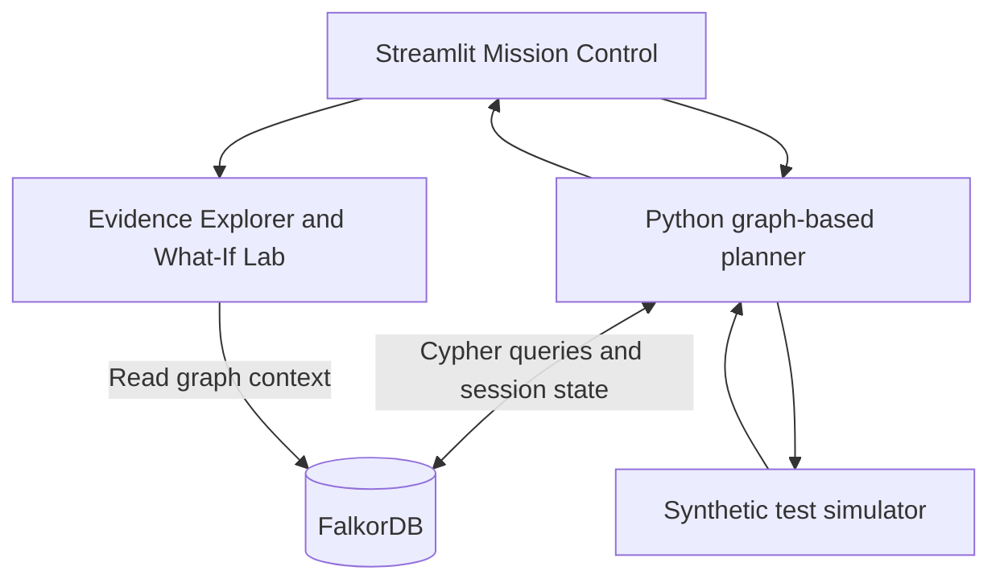
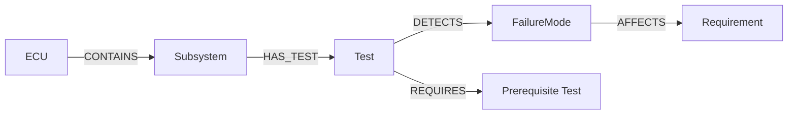

# TestPilot AI

**Graph-Powered Automotive ECU Test Planning with FalkorDB**

TestPilot AI is a working, deterministic agent prototype that uses **FalkorDB as its context and memory layer** to plan synthetic automotive ECU validation tests, explain selections, record results, and replan after failures. Its Streamlit dashboard provides **Mission Control**, an **Evidence Explorer**, a **Graph What-If Lab**, and persistent **History & Export**.

> **Scope:** This is a synthetic engineering demonstration. It does **not** communicate with vehicle ECUs, run real hardware tests, establish verified root causes, or claim ISO 26262 compliance.

## Graph Hacks 2026 submission

| Item | Details |
|---|---|
| Hackathon | Graph Hacks 2026 — WeMakeDevs × FalkorDB |
| Primary track | **Agents That Act on Connected Data** |
| Repository | [github.com/safiul167/TestPilot-AI](https://github.com/safiul167/TestPilot-AI) |
| Demo video | **https://youtu.be/9J_jN5zgk5g** |
| Deployment | **Local setup using Docker Compose and Streamlit**, documented below |
| AI assistance | Disclosed in [AI assistance disclosure](#ai-assistance-disclosure) |

## Problem

Automotive ECU validation involves choosing tests under a limited time budget. Tests cover overlapping failure modes, some require other tests to pass first, and observed failures should influence the next investigation. A static checklist does not represent these connected dependencies or retain decision context between runs.

## What TestPilot AI does

1. Retrieves test coverage, requirements, synthetic risk weights, detection probabilities, and prerequisite relationships from FalkorDB.
2. Excludes previously executed tests, tests with unmet prerequisites, and tests that cannot fit within the remaining budget.
3. Calculates a transparent priority score and selects the highest-ranked eligible next test.
4. Executes a **deterministic synthetic test scenario** (not a physical ECU test).
5. Stores the selected decision, test outcome, remaining time, and suspected failure-mode concerns in FalkorDB.
6. Reloads the graph context to recalculate the next recommendation.
7. Supports evidence-path visualization, non-destructive what-if comparisons, and export of session history.

## Architecture



### Why FalkorDB is essential

FalkorDB is the **operational source of truth**, not a decorative graph display. The planner traverses test-to-failure coverage (`DETECTS`), failure-to-requirement evidence (`AFFECTS`), and test prerequisites (`REQUIRES`). Session links connect decisions, recorded outcomes, and suspected failure modes. The agent cannot execute its current graph-powered planning workflow without those database queries.

The What-If Lab tests the importance of individual relationships: removing a selected `DETECTS` edge **from an in-memory copy of FalkorDB-derived evidence** can change the top recommendation. It does **not** edit the graph stored in FalkorDB.

## Graph data model

### Node types

| Node label | Purpose |
|---|---|
| `ECU` | Synthetic ADAS camera electronic control unit |
| `Subsystem` | Power supply, MCU/watchdog, Ethernet, or camera interface |
| `Test` | Validation scenario and simulated duration |
| `FailureMode` | Potential failure and synthetic risk weight |
| `Requirement` | Engineering requirement related to a failure mode |
| `Session` | Validation campaign and remaining time budget |
| `TestRun` | Persisted synthetic execution result |
| `Decision` | Persisted selection, priority score, and pre-test budget |

### Relationship types

| From | Relationship | To | Purpose |
|---|---|---|---|
| `ECU` | `CONTAINS` | `Subsystem` | Product structure |
| `Subsystem` | `HAS_TEST` | `Test` | Test association |
| `Test` | `DETECTS` | `FailureMode` | Coverage and detection probability |
| `FailureMode` | `AFFECTS` | `Requirement` | Engineering requirement traceability |
| `Test` | `REQUIRES` | `Test` | Prerequisite; arrow points toward the prerequisite |
| `Session` | `HAS_DECISION` | `Decision` | Decision memory |
| `Decision` | `SELECTS` | `Test` | Selected action |
| `Session` | `HAS_RUN` | `TestRun` | Execution history |
| `TestRun` | `FOR_TEST` | `Test` | Test associated with a recorded run |
| `TestRun` | `SUSPECTS` | `FailureMode` | Unconfirmed failure-mode concern |

**Initial synthetic engineering graph:** 1 ECU, 4 subsystems, 8 tests, 6 failure modes and 6 requirements — **25 nodes and 32 relationships** before session data is added.



Additional information: [graph architecture and detailed model](docs/graph_model.md), [Cypher queries](docs/queries.cypher), and the parameterized queries in [`src/run_agent.py`](src/run_agent.py).

### Core Cypher queries used by the agent

These examples correspond to the **actual data model and queries** in [`src/run_agent.py`](src/run_agent.py). The Python client supplies `$sid` as a parameter. In the FalkorDB Browser, run each query separately and substitute an existing session ID for `$sid` if you are not passing parameters.

**1. Multi-hop engineering evidence — risk coverage and requirements**

```cypher
MATCH (t:Test)-[d:DETECTS]->(f:FailureMode)-[:AFFECTS]->(r:Requirement)
RETURN t.id, t.name, t.duration_min,
       f.id, f.risk_weight, d.detection_probability, r.id
```

**2. Graph-based test prerequisites**

```cypher
MATCH (t:Test)-[:REQUIRES]->(p:Test)
RETURN t.id AS test_id, p.id AS prerequisite_id
```

**3. Load persistent session results**

```cypher
MATCH (s:Session {id:$sid})-[:HAS_RUN]->(run:TestRun)-[:FOR_TEST]->(t:Test)
RETURN t.id, run.outcome
```

**4. Load suspected failure modes from previous executions**

```cypher
MATCH (s:Session {id:$sid})-[:HAS_RUN]->(run:TestRun)-[:SUSPECTS]->(f:FailureMode)
RETURN DISTINCT f.id
```

**5. Retrieve remaining session budget**

```cypher
MATCH (s:Session {id:$sid})
RETURN s.remaining_minutes
```

Agent decisions and test-run outcomes are written with parameterized `MERGE` and `SET` statements, as shown in [`src/run_agent.py`](src/run_agent.py). Additional runnable read-only query examples are available in [`docs/queries.cypher`](docs/queries.cypher).

## Test selection and automatic replanning

For each **eligible** test, the agent calculates a synthetic *risk-coverage benefit per minute* using this formula (shown in plain text for reliable GitHub rendering):

```text
Priority(test) =
    SUM(risk_weight[f] * detection_probability[test,f] * concern_multiplier[f])
    / duration_minutes[test]
```

**Plain-text equivalent:** `Priority(test) = SUM(risk_weight × detection_probability × concern_multiplier) / test_duration_minutes`

| Symbol | Meaning |
|---|---|
| `t` | Candidate test |
| `f` | Failure mode covered by the candidate test |
| `F_t` | Failure modes connected to test `t` |
| `R_f` | Synthetic risk weight for failure mode `f` |
| `P_(t,f)` | Synthetic detection probability for test `t` and failure mode `f` |
| `M_f` | Concern multiplier: 2.0 if failure mode `f` is suspected in the current session; otherwise 1.0 |
| `D_t` | Simulated test duration in minutes |

A test is eligible only when it has **not** already been executed in the current session, **all prerequisites have passed**, and it fits within the remaining simulated time. The planner chooses the highest scoring eligible test, breaking ties by test ID.

### Worked example — TEST-002 (Power Rail Monitoring)

TEST-002 has two synthetic coverage relationships:

| Failure mode | Risk weight | Detection probability | Concern multiplier (initial) |
|---|---:|---:|---:|
| `FM-001` — Unexpected ECU Reset | 8 | 0.50 | 1.0 |
| `FM-002` — Undervoltage Detection Failure | 9 | 0.95 | 1.0 |

With a duration of 8 minutes:

```text
TEST-002 priority = (8 * 0.50 + 9 * 0.95) / 8
                  = (4.00 + 8.55) / 8
                  = 1.56875
                  = 1.569 (rounded to 3 decimal places)
```

This is a **greedy demonstration heuristic**, not a calibrated automotive safety-risk metric, a validated detection probability model, or a globally optimal schedule.

### Failure-driven synthetic example

1. A new session recommends **TEST-002 — Power Rail Monitoring** (score **1.569**).
2. The deterministic simulator returns `FAIL`, storing a suspicion of **FM-002 — Undervoltage Detection Failure**.
3. Eight simulated minutes are deducted and the persisted graph history is reloaded. The new recommendation is **TEST-001 — Power Transient** (score **1.720**).
4. TEST-001 returns `PASS`, but the earlier FM-002 concern remains an *unresolved hypothesis*.
5. The agent continues selecting eligible tests while respecting prerequisite and budget constraints.

### Graph What-If Lab

Temporarily exclude `TEST-002 -[:DETECTS]-> FM-002` from the evidence used for scoring, without writing a deletion to FalkorDB:

| Evidence configuration | Top recommendation | Score |
|---|---|---:|
| Original graph-derived evidence | TEST-002 — Power Rail Monitoring | 1.569 |
| Hypothetical edge removed | TEST-005 — MCU Reset Handling | 1.185 |

This is an **evidence sensitivity experiment**, not a physical fault injection, database mutation, or validated causal intervention.

## Interactive Streamlit dashboard

- **Mission Control:** simulated remaining time, completion status, failure count, unresolved concerns, and graph-derived recommendation.
- **Execute one / execute all:** run one synthetic test or continue while eligible tests remain.
- **Eight-test matrix:** duration, result, and prerequisites for each synthetic test.
- **Evidence Explorer:** show the `Test → FailureMode → Requirement` paths and underlying probabilities.
- **Graph What-If Lab:** compare baseline priority rankings against a temporary edge-removal scenario.
- **History & Export:** show persisted test outcomes and agent decisions; download a JSON report.

## Verified development results

Results observed during development, including a fresh GitHub clone tested against an **already-running, seeded FalkorDB instance**:

| Check | Observed result |
|---|---|
| Automated regression tests | **12/12 passed** (7 planner/integration + 5 What-If tests) |
| Full synthetic test campaign | **8/8 scenarios executed** |
| Synthetic outcomes | **7 PASS, 1 FAIL** |
| Full-campaign time budget | **120 simulated minutes** |
| Duration used / remaining | **93 / 27 simulated minutes** |
| Restart persistence | Stored graph and sessions survived a container restart |
| What-If Lab | Excluding one evidence relationship changed the leading recommendation |

These checks are **prototype-level**; they do not establish physical ECU performance, production reliability, or functional-safety compliance. The fresh-clone test did **not** independently validate initialization on a completely empty FalkorDB deployment.

## Quick start — Windows PowerShell

### Requirements

- Windows with **Python 3.12**, **Git**, and **Docker Desktop** running.
- Local ports **6379** (FalkorDB), **3000** (FalkorDB Browser), and **8501** (Streamlit) available.
- No GPU, cloud account, or LLM API key required.

### 1. Clone the project

```powershell
git clone https://github.com/safiul167/TestPilot-AI.git
cd TestPilot-AI
```

### 2. Start FalkorDB

```powershell
docker compose up -d
docker compose ps
docker compose exec -T falkordb redis-cli PING
```

Wait for `PONG`. Immediately after container startup, `Connection refused` may appear briefly; wait and retry. Docker Compose is configured with a persistent named volume.

### 3. Create the Python environment and install dependencies

```powershell
py -3.12 -m venv .venv
.\.venv\Scripts\python.exe -m pip install -r requirements.txt
```

### 4. Seed a **fresh empty** FalkorDB database

```powershell
.\.venv\Scripts\python.exe src\seed_graph.py
.\.venv\Scripts\python.exe src\seed_validation_data.py
```

Expected engineering graph: **25 nodes and 32 relationships**. Seed the graph once on a new database. **Do not run `seed_graph.py` against an existing populated graph**: its assertions target the initial five-node stage, and its `CREATE` statements should not be used to reset an existing dataset.

### 5. Run all 12 automated tests

```powershell
.\.venv\Scripts\python.exe -m pytest tests/test_agent.py tests/test_what_if.py -v
```

Expected with the documented synthetic graph: **12 passed**. Some checks require the local FalkorDB service and seeded graph to be running.

### 6. Run Streamlit

```powershell
.\.venv\Scripts\python.exe -m streamlit run app.py
```

Open [http://localhost:8501](http://localhost:8501). The FalkorDB Browser is available at [http://localhost:3000](http://localhost:3000).

### 7. Demonstrate the agent

Choose a **new session ID** (for example `DEMO-VIDEO-001`), because saved sessions retain their own budgets and test history.

- **60-minute constrained scenario:** some of the eight tests remain unexecuted because their total simulated duration is 93 minutes.
- **120-minute complete scenario:** execute **ONE** synthetic test to demonstrate the failure-informed replan, then execute **ALL remaining** eligible tests. With the unchanged seed data and simulator, expect **8/8 completed**, **7 PASS / 1 FAIL**, and **27 minutes left**.
- **What-If Lab:** choose fresh hypothetical session mode and the `TEST-002 → FM-002` coverage connection; show the changed leading recommendation.
- **History & Export:** show decisions and test results saved in FalkorDB; download the JSON report.

### Local deployment note

The prototype has **no hosted live deployment**. Judges can run it with these Docker and Python instructions. The `localhost` links only work on the computer running the services. Stored graph state is retained in the Docker volume; `docker compose down -v` would remove that volume and must **not** be used unless intentionally resetting local data.

## Repository layout

```text
TestPilot-AI/
├── README.md
├── app.py                         # Streamlit dashboard
├── docker-compose.yml             # FalkorDB + persistent volume
├── requirements.txt
├── docs/
│   ├── graph_model.md             # Detailed graph model and architecture
│   └── queries.cypher             # Cypher query reference
├── src/
│   ├── run_agent.py               # Stateful synthetic test execution
│   ├── test_planner.py            # Initial CLI prioritizer
│   ├── what_if.py                 # In-memory evidence-ablation comparison
│   ├── seed_graph.py              # Five-node starter graph
│   └── seed_validation_data.py    # Expanded ECU graph
└── tests/
    ├── test_agent.py              # Seven regression checks
    └── test_what_if.py            # Five additional checks
```

## Demonstration video

**Video URL: PENDING.** Replace this with an accessible public or unlisted YouTube video link **before submission**. Recommended contents: graph structure, first failed synthetic test and automatic replanning, What-If Lab, 8/8 synthetic campaign, persisted session history, and test evidence.

## Limitations and responsible use

- **Synthetic only:** all engineering data, risk weights, detection probabilities, and test outcomes are invented demonstration data.
- No ECU hardware interface, real hardware-in-the-loop execution, or physical vehicle testing.
- No verified root-cause diagnosis, ISO 26262 verification, or functional-safety certification.
- `TEST-002` always produces a synthetic `FAIL` in the current simulator; the remaining tests are deterministic synthetic passes.
- The planner uses a greedy risk-benefit-per-minute heuristic, not a globally optimal test schedule.
- The What-If Lab runs on an in-memory copy of graph-derived evidence; it does not edit FalkorDB.
- Intended for local, single-user demonstration, not production concurrent access or real-time test control.

## AI assistance disclosure

AI coding assistance was used for architecture discussions, code drafting, debugging guidance, tests, interface design, and documentation. The participant integrated and verified the prototype and is responsible for explaining the graph model, Cypher queries, implementation, and engineering tradeoffs.

## License

No license has been added. By default, public repository visibility does not grant broad reuse permission; copyright remains with its respective owner(s).
